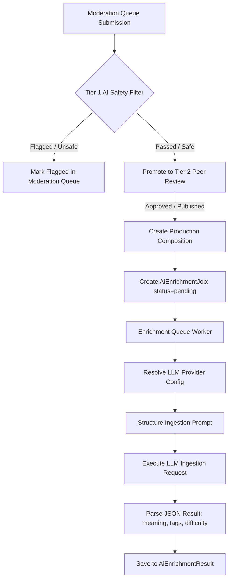

# AI Safety Filter & Metadata Enrichment (AI-Enrichment-Flow)

This document describes the safety filtering, hagiographical classification, and semantic enrichment loops using free-tier LLM providers.

---

## 1. Enrichment Architecture Diagram

---

## 2. Codebase Reference & Implementations

### 2.1 LLM Provider Resolution
File: [free-provider.ts](file:///c:/Users/Dinesh%20Nikam/Desktop/mirai/varkari/src/ai-enrichment/free-provider.ts)
- `resolveFreeConfig()`: Auto-detects and resolves the best available provider.
  1. Traditional `LLM_API_KEY` (OpenAI proxy).
  2. Groq Cloud LPU inference (`GROQ_API_KEY` using `mixtral-8x7b-32768` or `llama-3.3-70b-versatile`).
  3. Google Gemini Cloud free tier (`GEMINI_API_KEY` using `gemini-1.5-flash`).
  4. Local Ollama host (`gemma2:9b` or `llama3.1:8b`).

### 2.2 Tier 1 AI Safety Filtration
File: [moderation-workflow.ts](file:///c:/Users/Dinesh%20Nikam/Desktop/mirai/varkari/src/lib/moderation-workflow.ts)
- `processTier1AI(queueId)`:
  - Invoked automatically when a composition scan or Suggestion enters the moderation queue.
  - Queries the LLM asking if the text is safe and contains coherent Marathi devotional content.
  - If unsafe/incoherent, flags it with an audit reason; otherwise, promotes it immediately to Tier 2 (Peer Review).
  - Falls back gracefully to promote to Tier 2 directly if no API keys or local LLM endpoints are running.

### 2.3 Batch Queue & Enrichment Ingestion
Files: [queue.ts](file:///c:/Users/Dinesh%20Nikam/Desktop/mirai/varkari/src/ai-enrichment/queue.ts), [enricher.ts](file:///c:/Users/Dinesh%20Nikam/Desktop/mirai/varkari/src/ai-enrichment/enricher.ts) & [prompts.ts](file:///c:/Users/Dinesh%20Nikam/Desktop/mirai/varkari/src/ai-enrichment/prompts.ts)
- `processQueue(batchSize)`: Queries pending enrichment jobs in `AiEnrichmentJob` table, processes them sequentially, increments retry counts on failures, and marks success.
- `enrichComposition(compositionId, config)`: Coordinates the LLM call using prompts defined in `prompts.ts`.
- `parseResponse(content)`: Extracts structural JSON data returning:
  - **`meaning`**: Plain Marathi explanation of the composition's stanzas.
  - **`summary`**: A concise overview of the devotional theme.
  - **`tags` & `keywords`**: Indexing tags (e.g. `भक्ती`, `वैराग्य`).
  - **`difficulty`**: Classification (Easy / Medium / Hard).
  - **`confidence`**: Scores assessing certainty of metadata association.
