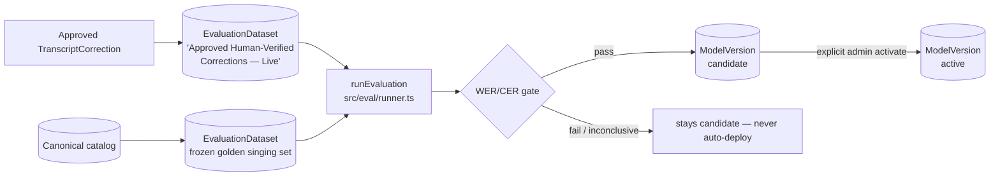

# Audio Platform — Architecture (Record → Lyrics Intelligence)

Living documentation of the audio platform as implemented (T1–T5). It covers
the recording pipeline, the canonical-correction loop, the evaluation/
model-governance loop, the personal library + player, and the discovery
engine. Terminology is shared with the REST API reference
([audio-platform-api.md](./audio-platform-api.md)) and the implementation
plan ([audio-platform-plan.md](./audio-platform-plan.md)).

> Honesty contract (spec §32): nothing here claims "100% accurate
> transcription". Every stage ships a measurable confidence + human-review
> system, and the docs call out exactly which steps are real, which are
> optional/opportunistic, and which degrade honestly when a tool is missing.

---

## 1. System Overview

```mermaid
flowchart LR
    subgraph Record["/record — user"]
        Mic[Microphone / file / YouTube URL] --> Upload[POST /api/acquire/upload]
    end

    Upload --> Jobs[AudioProcessingJob queue]
    Jobs --> Pipeline[Enhancement Pipeline<br/>src/audio/enhance-pipeline.ts]
    Pipeline --> Versions[UploadedFileVersion<br/>original + enhanced]
    Pipeline --> Transcribe[Transcription<br/>src/lib/extractors/audio-extractor.ts]

    Transcribe --> Match[Composition Matcher<br/>src/canonical/composition-matcher.ts]
    Match --> Correct[Canonical Corrector<br/>src/canonical/canonical-corrector.ts]
    Correct --> PendingCorr[(TranscriptCorrection<br/>pending)]
    PendingCorr --> Mod[Moderator verify<br/>POST /api/admin/audio/corrections/[id]/verify]

    Mod -- approve --> Eval[(EvaluationDataset<br/>'...Live' + sample)]
    Eval --> EvalLoop[Evaluation Runner<br/>src/eval/runner.ts]
    EvalLoop --> Registry[(ModelVersion registry)]
    Registry --> Mod

    Versions --> Library[Personal Library<br/>/library/recordings + playlists]
    Library --> Player[Premium Player<br/>components/floating-player.tsx]

    Discovery[DiscoveryWorker<br/>src/discovery] --> Pipeline
```

Two long-running loops keep the system honest:

1. **Moderation loop** — a correction only becomes training/eval data after a
   moderator approves it (owner can also hand-edit and resubmit).
2. **Evaluation loop** — a new ASR model is registered as `candidate`, scored
   on frozen golden datasets, and **never auto-deployed**: activation requires
   an explicit admin action after a passing WER/CER gate.

---

## 2. Recording & Upload

**Surface:** `/record` page → `POST /api/acquire/upload` (multipart).

| Input field       | Purpose                                                        |
| ----------------- | -------------------------------------------------------------- |
| `file`            | Blob (webm/opus, wav, mp3, …) or any supported upload format   |
| `url`             | YouTube URL (routed to `handleYouTubeUrl`)                     |
| `title`           | Optional custom title                                          |
| `isRecording`     | `"true"` when the in-browser recorder produced the file        |
| `rightsStatus`    | Rights declaration (recording page) → `RightsRecord`           |
| `consentGranted`  | Consent declaration → gates publication                        |
| `publicationPermission` | Explicit publication intent → gates auto-publish         |
| `attribution`     | Attribution string                                             |

Key behaviors:

- Format routing lives in `src/lib/file-validator.ts`
  (`validateUpload`, `classifyUploadFormat`); audio/webm is accepted as audio.
- Audio goes through the processing-queue pattern
  (`src/lib/audio-processing.ts`) — upload returns immediately; work happens
  in `processAudioProcessingJobs()`, so the user never waits on the request.
- Rights/consent are stored on `RightsRecord` and gate whether the recording
  may ever be submitted for publication (`src/lib/rights.ts` `decideRights`).

**Honest limits:** unsupported/oversized/corrupt inputs return a useful error
with retry guidance; nothing is silently dropped.

---

## 3. Enhancement Pipeline

```mermaid
flowchart TD
    Raw[Raw buffer] --> V[1. validate-audio<br/>format / size / duration gates]
    V --> A[2. analyze-audio<br/>ffprobe: duration, sample rate,<br/>channels, codec, loudness]
    A --> E[3. enhance-audio<br/>profile filter chain → 16 kHz mono WAV]
    E --> I{isolateVocals?}
    I -- yes --> Demucs[4. vocal-isolate<br/>demucs when installed]
    I -- no --> SkipI[skipped[]: honest reason]
    Demucs --> S[5. vad: silence segmentation<br/>ffmpeg silencedetect]
    SkipI --> S
    S --> Out[EnhancedAsset<br/>buffer + metadata + skipped[]]
```

Files: `src/audio/validate-audio.ts`, `src/audio/analyze-audio.ts`,
`src/audio/enhance-audio.ts`, `src/audio/vocal-isolate.ts`,
`src/audio/vad.ts`, orchestrated by `src/audio/enhance-pipeline.ts`
(`PIPELINE_VERSION = 't2-v1'`).

**Profiles** (`src/audio/profiles.ts`, 8): Clean Voice, Temple Recording,
Live Bhajan, Kirtan, Group Singing, Outdoor Wari, Home Recording, Low Quality
Recording — each a distinct filter chain selected by `profileId`.

**Invariants:**

- The original buffer is never modified; the pipeline works on a temp copy.
- Every derived asset is returned as a fresh buffer + metadata for the caller
  to persist as an `UploadedFileVersion` (label `enhanced`).
- `skipped[]` honestly lists every stage that could not run and why
  (e.g. demucs not installed, ffprobe missing) — no fake processing.
- Capability detection is centralized in `src/audio/tooling.ts`.

---

## 4. Transcription → Matching → Correction

### 4.1 Transcription

`src/lib/extractors/audio-extractor.ts` — Whisper (OpenAI/Groq) with honest
failure. The result is stored on `UploadedFile.extractedText` with
`extractionConfidence`.

### 4.2 Composition matching

`src/canonical/composition-matcher.ts`:

1. Search Meilisearch + canonical corpus.
2. Score candidates (phonetic + fuzzy similarity on title/fragments).
3. Rank top-N (`MAX_MATCH_CANDIDATES = 5`).
4. Persist `CompositionMatch` rows; **below `MATCH_CONFIRM_THRESHOLD = 0.62`
   the system refuses to suggest a match** (never silently misidentifies).

The user confirms/rejects a candidate explicitly:
`POST /api/acquire/match` `{ uploadId, compositionId, action }`.

### 4.3 Canonical correction

`src/canonical/canonical-corrector.ts` — runs **only** against a *confirmed*
match (never a mere candidate):

- `alignLines` / `computeWordDiffs` — line + word alignment.
- `alignAndCorrect` — corrects a line only at `LINE_CORRECT_THRESHOLD = 0.8`
  similarity; the original ASR is preserved verbatim.
- Output: `correctedText`, `diffJson`, `confidence`, `errorType`, stored as a
  **pending** `TranscriptCorrection` via `saveTranscriptCorrection` (one
  pending per upload; newer runs replace it; approved never overwritten).
- `alignManualEdit` — the owner's hand edit realigned against the *original*
  ASR (never silently reverted against canonical).
- `verifyTranscriptCorrection` — moderator approve/reject gate. **On approve,
  `appendApprovedCorrection` writes a sample into the live `EvaluationDataset`
  (idempotent via `sourceCorrectionId`).**

---

## 5. Evaluation & Model Governance (T3)



- **Registry** (`src/eval/registry.ts`): `registerModel`, `getRegistry`,
  `getActiveModel`, `activateModel` (refuses unless latest run **passed**),
  `rollbackModel`, `retireModel`. Exactly one active model per type.
- **Runner** (`src/eval/runner.ts`): two honest modes —
  `regression` (real approved corrections; reference = approved correctedText,
  hypothesis = verbatim original ASR) and `golden` (frozen dataset; samples
  without a hypothesis are skipped and **counted**, never silently dropped).
- **Gates** (`src/eval/gates.ts`): WER/CER thresholds, `compareRuns` A/B
  against the active model's baseline, `DEFAULT_GATE_THRESHOLDS`.
- **Datasets** (`src/eval/datasets.ts`): `createGoldenDataset` (frozen),
  `seedGoldenDatasetsFromCatalog`, `materializeRegressionSamples`,
  `appendApprovedCorrection`, `seedRegressionDatasetFromApprovedCorrections`.
- Every run persists an auditable `EvaluationRun` row (aggregate + per-sample
  metrics + gating result + A/B comparison).

**Never auto-deploy:** a new ASR model enters as `candidate`; activation is an
explicit admin action gated on a passing evaluation.

---

## 6. Personal Library, Playlists & Player (T4)

- **Library** (`src/lib/library.ts`, `/library/recordings`):
  `listRecordings` (versions: original + enhanced, transcript, bookmark,
  last-played), `getRecording`, `renameRecording`, `toggleRecordingBookmark`,
  `deleteRecording` (removes the recording **and** all derived storage files,
  transcript, bookmarks, history, playlist items, moderation rows — one
  transaction), `recordPlayback`.
- **Playlists** (`src/lib/playlists.ts`, `/playlists`): CRUD, add/remove
  items (a composition **or** a recording — `assertSingleTarget` never both),
  atomic reorder. Pure ordering helpers (`reorderItems`, `moveItemById`) are
  unit-tested.
- **Player** (`components/floating-player.tsx`): queue driven by a real
  `play-track` CustomEvent (no fake SoundHelix tracks), playback speed
  (0.5×–1.5×), repeat off/all/one, shuffle, fullscreen, Media Session API,
  keyboard shortcuts, synced lyrics with tap-to-seek. Pure logic lives in
  `src/lib/player-logic.ts`.

---

## 7. Discovery Engine (T5)

```mermaid
flowchart LR
    Registry[(ContentSource registry<br/>19 seeded sources)] --> Due[due-sources.ts<br/>per-source due selection<br/>scrapeInterval + lastFetchAt + robots]
    Due --> Order[quality.ts<br/>composite crawl-priority score]
    Order --> Runner[acquire-runner.ts<br/>route by scraperType]
    Runner --> WS[acquire-wikisource.ts<br/>exported acquire() core]
    Runner --> IA[acquire-internet-archive.ts<br/>exported acquire() core]
    WS --> Pipeline[Crawl4AI pipeline<br/>extract → segment → normalize<br/>→ content-hash dedup → score]
    IA --> Pipeline
    Pipeline --> Comp[(Composition rows)]
    Pipeline --> Job[(DiscoveryJob<br/>itemsFound/new/duplicates)]
```

- `src/discovery/quality.ts` — pure source-quality scoring (trust, freshness,
  duplicate ratio, error rate, license, extraction reliability, approved
  ratio) driving crawl priority.
- `src/discovery/due-sources.ts` — per-source scheduling, robots-respecting.
- `src/discovery/acquire-runner.ts` — routes a source to the right acquisition
  core by `scraperType`; tags parsed from JSON, category-filtered.
- The worker (`src/discovery/discovery-worker.ts`) replaced its old fake
  `*0.7` dedup and dead `resolveScraper`/`autoDiscover` paths with real
  acquisition routing + real `DiscoveryJob` rows.
- `scripts/acquire-wikisource.ts` / `scripts/acquire-internet-archive.ts` were
  refactored to export reusable `acquire()` cores with thin CLI `main()`s.
- Enum safety: `normalizeCompositionType()` maps free-form type strings
  (`'abhang'`, `'आरती'`) to the `CompositionType` enum — Postgres rejects
  lowercase values (the old SQLite shim tolerated them).

---

## 8. Data Model (audio-relevant tables)

| Table (Postgres)           | Purpose                                        |
| -------------------------- | ---------------------------------------------- |
| `uploaded_files`           | Uploads incl. recordings (`format=audio`)      |
| `uploaded_file_versions`   | original + enhanced assets, versioned          |
| `audio_processing_jobs`    | enhancement/transcription job queue            |
| `rights_records`           | rights/consent/publication gates               |
| `transcript_corrections`   | pending/approved/rejected corrections          |
| `composition_matches`      | suggested/confirmed/rejected candidates        |
| `model_versions`           | ASR/singing model registry (never auto-active) |
| `evaluation_datasets`      | frozen golden sets + live approved-corrections |
| `evaluation_samples`       | one golden sample (unique `source_correction_id`) |
| `evaluation_runs`          | auditable scored runs + gate + A/B             |
| `playlists` / `playlist_items` | personal playlists (composition OR recording) |
| `playback_history`         | listen history                                 |
| `audio_favorites`          | bookmarks                                      |
| `content_sources`          | discovery registry                             |
| `discovery_jobs`           | per-cycle crawl results                        |

---

## 9. Security & Privacy Invariants

- **Ownership gates:** library/recordings/playlist/correction routes return
  `404` (not `403`) for foreign or missing resources — no existence leak.
- **Auth:** NextAuth session; admin routes use `requireAdmin()`.
- **Sensitive data:** recordings are private by default; publication requires
  explicit user consent + permission and moderator review.
- **No fake claims:** low-confidence transcripts and unmatched recordings go
  to review; confidence/quality scores are surfaced, not hidden.

---

## 10. Assumptions, Gaps & Follow-ups

- **Assumption:** dev Postgres is the runtime DB (`.env` `DATABASE_URL`); the
  SQLite shim (`src/db/client-sqlite.ts`) is a fallback and has no
  `$transaction` support.
- **Gap:** cross-source canonical merge (phonetic/semantic dedup →
  `CanonicalSourceMapping`) is not yet wired — only content-hash dedup runs.
- **Gap:** FAQ page (schema-driven, searchable, JSON-LD) is planned but not
  built.
- **Follow-up:** run `scripts/seed-eval.ts` to register the `whisper-1`
  baseline and materialize the frozen golden dataset; then run the first
  gated evaluation on real approved corrections.
