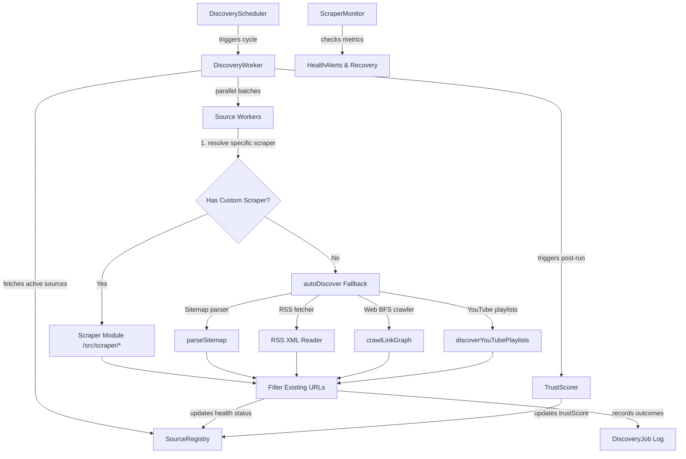

# Autonomous Content Discovery & Ingestion Flow

This document details the architecture, execution pipeline, and control flows of the **Autonomous Content Discovery and Growth Engine** in Vitthalaya. 

> [!NOTE]
> **Source Code Analysis Notice**
> This documentation was generated by directly analyzing the live TypeScript implementation and database schemas in the codebase.
>
> **Code Files Reviewed:**
> - [src/discovery/scheduler.ts](file:///c:/Users/Dinesh%20Nikam/Desktop/mirai/varkari/src/discovery/scheduler.ts) — Daemon/one-shot scheduler & cycle execution orchestrator
> - [src/discovery/discovery-worker.ts](file:///c:/Users/Dinesh%20Nikam/Desktop/mirai/varkari/src/discovery/discovery-worker.ts) — Ingestion processor, scraper resolver, and crawler fallback engine
> - [src/discovery/source-registry.ts](file:///c:/Users/Dinesh%20Nikam/Desktop/mirai/varkari/src/discovery/source-registry.ts) — Content source registry state management (CRUD, status, health status)
> - [src/discovery/trust-scorer.ts](file:///c:/Users/Dinesh%20Nikam/Desktop/mirai/varkari/src/discovery/trust-scorer.ts) — Multi-factor trust scoring engine
> - [src/discovery/scraper-monitor.ts](file:///c:/Users/Dinesh%20Nikam/Desktop/mirai/varkari/src/discovery/scraper-monitor.ts) — Alert generation, health auditing, and auto-recovery daemon
> - [prisma/schema.prisma](file:///c:/Users/Dinesh%20Nikam/Desktop/mirai/varkari/prisma/schema.prisma) — Definitions of `ContentSource` and `DiscoveryJob` database models

---

## 1. System Overview & Architecture

The Growth Engine continuously expands the platform's corpus of devotional texts (Abhangs, Bhajans, Gaulanis, Stotras, and Aartis) from external sources. It runs as a background service checking sitemaps, RSS feeds, YouTube playlists, or performing Breadth-First Search (BFS) crawling on authorized web domains.

---

## 2. Ingestion & Execution Pipeline

### Phase A: Scheduling and Orchestration
The discovery cycle is kicked off by `DiscoveryScheduler` (`src/discovery/scheduler.ts`).
- **CLI Options**:
  - `--daemon`: Runs as a continuous background daemon repeating cycles at a configured interval.
  - `--run-once`: Triggers a single execution cycle and immediately exits.
  - `--interval=N`: Adjusts the interval between cycles in hours (default is `6` hours).
- **Concurrency Mutex**: To prevent overlapping cycles from exhausting system resources, the scheduler implements a boolean flag (`cycleInProgress`) acting as a local mutex. If a cycle is triggered while the previous one is active, the run is skipped and the last generated report is returned.

### Phase B: Worker Execution
The worker (`src/discovery/discovery-worker.ts`) coordinates parallel batch processing:
1. **Source Discovery**: Fetches all sources with status `ACTIVE` from the database.
2. **Batching**: Splits active sources into parallel execution chunks (default concurrency: `3` sources at a time).
3. **Execution & Rate-Limiting**:
   - Executes `runForSource` for each item in the batch.
   - Respects a rate limit pause of `2000ms` between sequential items inside each batch to be polite to targeted web hosts.
   - Pauses for `1000ms` between batches.

### Phase C: Scraper Resolution & Auto-Discovery Fallback
For each targeted content source, the engine evaluates ingestion strategies:
1. **Custom Scraper**: If `scraperType` is specified on the source, the engine dynamically imports `/src/scraper/${scraperType}.ts`.
2. **Auto-Discovery**: If no custom scraper is configured, the worker utilizes the `autoDiscover` function with four fallback strategies:
   - **SITEMAP**: Iterates through common paths (e.g., `/sitemap.xml`, `/sitemap_index.xml`) and parses links.
   - **RSS**: Checks typical feed channels (e.g., `/feed.xml`, `/rss/`) and extracts links via regular expression patterns.
   - **WEBSITE**: Crawls the host's HTML link graph via BFS (Breadth-First Search) up to depth `2` and max `50` pages, filtering links against configured allowed and excluded path globs.
   - **YOUTUBE**: Extracts playlists using search terms or source tags.

---

## 3. Source Registry, Health & Auto-Disabling

Every execution cycle logs technical metrics to update the reliability status of the content sources.

### Health Logging
- **Successful Fetch**: Recorded via `SourceRegistry.recordSuccess`. It aggregates total composition counts, updates `lastFetchAt`, and resets `consecutiveErrors` and `errorRate` to `0`.
- **Failed Fetch**: Recorded via `SourceRegistry.recordError`. It increments `consecutiveErrors`, stores the error message in `lastErrorMessage`, and logs the error timestamp.

### Auto-Disabling Mutex Rules
If a source fails repeatedly, the registry executes a safety cutoff:
- A progressive error rate is calculated: `errorRate = min(1.0, (consecutiveErrors / 10) * 0.5)`.
- If `consecutiveErrors` reaches **`3`**, the source is automatically disabled (`status: 'DISABLED'`).
- A log entry is appended to the source's `notes` detailing the failure.

---

## 4. Trust Scorer & Component Weighting

After every full discovery run, `TrustScorer.recalculateAll` (`src/discovery/trust-scorer.ts`) evaluates all registered sources and generates a composite trust score between `0.0` and `1.0`.

### Scoring Formula
The final score is a weighted sum of thirteen reliability components:

$$\text{Trust Score} = \sum (\text{Component Value} \times \text{Weight})$$

| Component | Description | Weight |
| :--- | :--- | :---: |
| `moderationPassRate` | Percentage of compositions passing AI moderation | **20% (0.20)** |
| `verifiedRatio` | Percentage of compositions successfully verified | **15% (0.15)** |
| `uptime` | Success rate of scraping runs in the past 7 days | **12% (0.12)** |
| `correctionRate` | Percentage of compositions requiring subsequent edits (inverted) | **10% (0.10)** |
| `responseTimeScore` | Network response time score (clamped; <1s = 1.0, >10s = 0.1) | **8% (0.08)** |
| `licenseClarity` | Presence of a verified license declaration | **8% (0.08)** |
| `attributionQuality` | Configured attribution requirement status | **7% (0.07)** |
| `formatConsistency` | Internal parsing quality check | **5% (0.05)** |
| `communityReports` | Inverted count of user reports or flags | **5% (0.05)** |
| `domainAge` | Estimated age of the domain (clamped up to 10 years) | **3% (0.03)** |
| `editorFeedback` | Editor-submitted quality score | **3% (0.03)** |
| `hasRobotsTxt` | Valid presence of crawled `robots.txt` configuration | **2% (0.02)** |
| `crossSourceMatchRate` | Text similarity alignment against other trusted sources | **2% (0.02)** |

### Trust Tiers
The final score classifies the source into one of four quality tiers:
- **`0.90 – 1.00`**: **Verified** (Highly trusted; auto-ingests and publishes automatically).
- **`0.70 – 0.89`**: **Trusted** (Reliable source; subject to automated checks).
- **`0.40 – 0.69`**: **Suspicious** (Requires manual editor reviews).
- **`0.00 – 0.39`**: **Untrusted** (Disabled or strictly moderated).

---

## 5. Observability, Alerting & Auto-Recovery

The `ScraperMonitor` (`src/discovery/scraper-monitor.ts`) acts as the observability engine.

### Alert Classification
It dynamically checks all sources and flags three levels of alerts:
- **`CRITICAL`**: Emitted when a source is auto-disabled due to $\ge 3$ consecutive errors.
- **`WARNING`**: Triggered when a source's 7-day success rate falls below `80%` or its `trustScore` drops below `0.4`.
- **`INFO`**: Triggered when the deduplication rate rises above `90%`, indicating that the source has been fully harvested and is exhausted of new content.

### Automated Recovery Cycle
The monitor attempts to recover disabled sources in a self-healing loop:
1. Performs a basic connectivity check using a `HEAD` request (wrapped in a `10,000ms` abort timeout).
2. If the request returns a success code (`HTTP 2xx`), the source is marked `ACTIVE`, resetting consecutive errors to `0`.
3. If it fails, the source remains `DISABLED` and a manual administration notice is queued.
