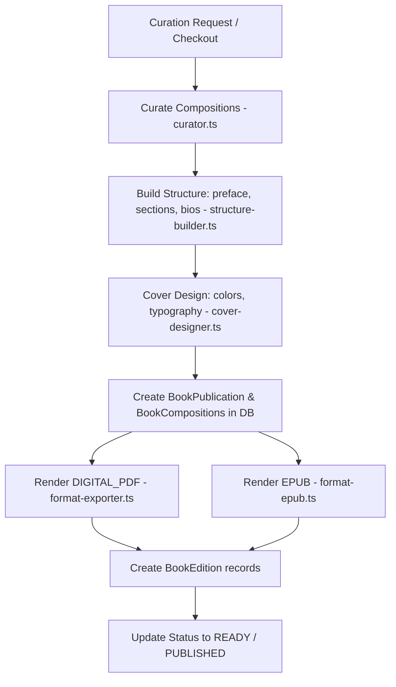

# Book Generation & Commerce compilation (Book-Generation-Commerce-Flow)

This document describes how Vitthalaya curates compositions and packages them into downloadable digital and print-ready editions (PDF/EPUB) linked to e-commerce print publishing partners.

---

## 1. Pipeline Curation & Compiling Flow

---

## 2. Codebase Reference & Implementations

### 2.1 Curation & Extraction
File: [curator.ts](file:///c:/Users/Dinesh%20Nikam/Desktop/mirai/varkari/src/book-generation/curator.ts)
- `curateBook(criteria)`: Filters compositions dynamically based on:
  - Saint criteria (e.g. compositions written by Tukaram Maharaj).
  - Deity criteria (e.g. dedicated to Vitthal).
  - Category criteria (e.g. only Gaulanis or Aartis).
  - Limit & sorting metrics (e.g. verified compositions sorted by length or popularity).

### 2.2 Structural Layout Compilation
File: [structure-builder.ts](file:///c:/Users/Dinesh%20Nikam/Desktop/mirai/varkari/src/book-generation/structure-builder.ts)
- `buildStructure(selection)`: Automatically formats book components:
  - **Preface & Afterword**: Contextual background of the selected tradition.
  - **Saint Biographies**: Dynamic hagiographical bios derived from database models.
  - **Section divisions**: Splitting compositions logically by deity or style (e.g. haripath vs abhangs).

### 2.3 Graphical Cover Art Layout
File: [cover-designer.ts](file:///c:/Users/Dinesh%20Nikam/Desktop/mirai/varkari/src/book-generation/cover-designer.ts)
- `designCover(publicationId, design)`: Prepares the graphical cover layout, specifying colors (e.g., standard saffron `bhagwa` or traditional temple maroon palettes), Noto Sans Devanagari typography, and margins.

### 2.4 Format Compilers
Files: [format-exporter.ts](file:///c:/Users/Dinesh%20Nikam/Desktop/mirai/varkari/src/book-generation/format-exporter.ts) & [format-epub.ts](file:///c:/Users/Dinesh%20Nikam/Desktop/mirai/varkari/src/book-generation/format-epub.ts)
- `exportBook(format, selection, structure, cover, layout, outputPath)`: Routes compilation depending on output extension:
  - **PDF Renderer**: Formats text into printable columns, adding headers, footers, page numbering, and table of contents.
  - **EPUB Compiler**: Generates compliant EPUB containers with HTML templates.

### 2.5 Orchestrator Pipeline
File: [book-generator.ts](file:///c:/Users/Dinesh%20Nikam/Desktop/mirai/varkari/src/book-generation/book-generator.ts)
- `generateBook(request)`: Executes the full compilation loop:
  1. Calls `curateBook`.
  2. Runs `buildStructure`.
  3. Stages drafts in `BookPublication` and `BookComposition` database tables.
  4. Triggers `exportBook` for each requested edition.
  5. Updates publication status to `READY` or `PUBLISHED` upon export completion.
