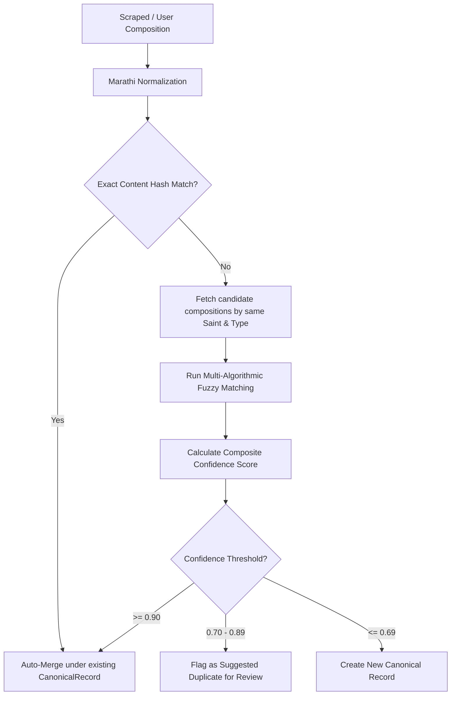

# Canonical Ingestion & Fuzzy Deduplication (Canonical-Deduplication-Flow)

This document describes how compositions from multiple sources are evaluated, normalized, and merged under a single hagiographical Canonical Record in the Vitthalaya platform.

---

## 1. Deduplication Flow Diagram

---

## 2. Codebase Reference & Implementations

### 2.1 Unicode Normalization Pipeline
File: [normalization.ts](file:///c:/Users/Dinesh%20Nikam/Desktop/mirai/varkari/src/canonical/normalization.ts)
- `normalizeForComparison(text)`: 
  - Standardizes text to Unicode Normalization Form C (`NFC`).
  - Cleans common Devanagari OCR scanning artifacts (e.g. replacing `द्न्या` -> `ज्ञा`).
  - Converts Chandrabindu (`ँ`) to Anusvara (`ं`) for phonetic consistency.
  - Strips Zero-Width Joiners (`ZWJ` / `ZWNJ`) and all punctuation.
  - Collapses duplicate whitespaces.
- `contentHash(text)`: Generates a fast base-36 non-cryptographic content signature via `Bun.hash()` over the normalized string for fast duplicate comparisons.
- `isMarathiText(text)`: Verifies that $>50\%$ of non-whitespace characters are in the Devanagari Unicode block `[\u0900-\u097F]`.

### 2.2 Multi-Algorithmic Fuzzy Matching
File: [fuzzy-matcher.ts](file:///c:/Users/Dinesh%20Nikam/Desktop/mirai/varkari/src/canonical/fuzzy-matcher.ts)
To ensure reliable deduplication of oral tradition compositions, the system runs four matching strategies and computes a weighted composite score:
1. **Levenshtein Distance** (`levenshteinSimilarity`): Measures character-level edit distance. Optimized memory footprint utilizing a single-row dynamic programming array.
2. **Jaccard Word Similarity** (`jaccardWordSimilarity`): Tokenizes text into word lists and computes the overlap coefficient $\frac{|A \cap B|}{|A \cup B|}$.
3. **N-gram Trigram Similarity** (`jaccardNgramSimilarity`): Measures overlap of 3-character Devanagari substrings, providing robustness against minor spelling variations.
4. **Line-level Similarity** (`lineLevelSimilarity`): Compares multi-line Ovi structures order-independently to match works where lines are grouped or split differently across sources.
5. **Title Similarity** (`titleSimilarity`): Compares titles after stripping Devanagari numerals (`०-९`) and checks for containment.

### 2.3 Confidence Scoring & Engine Orchestrator
Files: [confidence-score.ts](file:///c:/Users/Dinesh%20Nikam/Desktop/mirai/varkari/src/canonical/confidence-score.ts) & [canonical-engine.ts](file:///c:/Users/Dinesh%20Nikam/Desktop/mirai/varkari/src/canonical/canonical-engine.ts)
- `evaluateCandidate(composition, canonical)`: Scores a candidate record. Exits early if maximum algorithm similarity is $<0.30$.
- `determineAction(confidence, isManualOverride)`: Translates composite confidence scores into decisions:
  - **`auto_merge`** ($\ge 0.90$): Auto-joins the variant.
  - **`suggested_merge`** ($0.70 - 0.89$): Creates a suspected mapping and routes to the editor moderation queue.
  - **`auto_reject`** ($< 0.70$): Keeps the composition separate.
- `selectPrimaryText(mappings)`: Automatically selects the most authoritative text variant to represent the canonical composition, preferring reviewed files and longer, complete strings.
