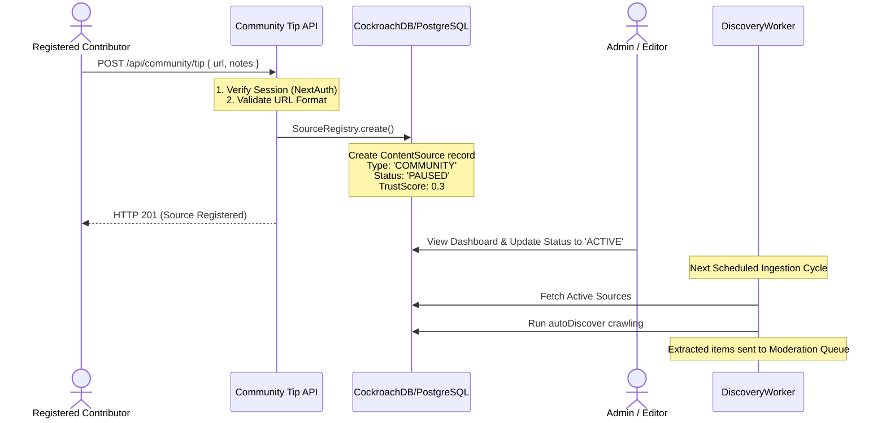
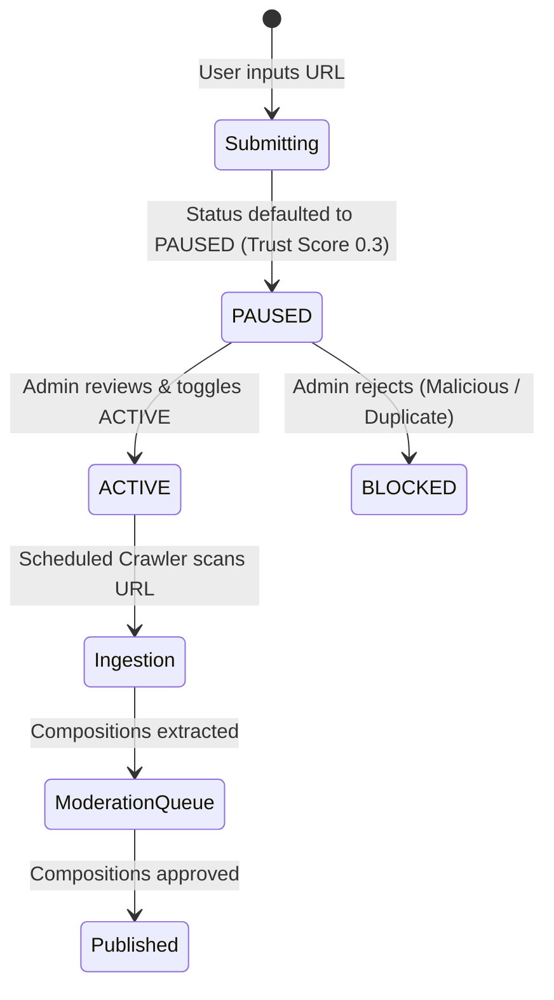

# Community Tip & Source Suggestion Flow

This document details the lifecycle, security controls, and processing steps of the **Community Tip and Source Suggestion pipeline** in Vitthalaya.

> [!NOTE]
> **Source Code Analysis Notice**
> This documentation was generated by directly analyzing the live TypeScript implementation and database schemas in the codebase.
>
> **Code Files Reviewed:**
> - [app/api/community/tip/route.ts](file:///c:/Users/Dinesh%20Nikam/Desktop/mirai/varkari/app/api/community/tip/route.ts) — Authentication, URL validation, and API handler
> - [src/discovery/source-registry.ts](file:///c:/Users/Dinesh%20Nikam/Desktop/mirai/varkari/src/discovery/source-registry.ts) — Registration defaults and state management
> - [src/community/verification.ts](file:///c:/Users/Dinesh%20Nikam/Desktop/mirai/varkari/src/community/verification.ts) — Trust verification and source rating adjustments
> - [prisma/schema.prisma](file:///c:/Users/Dinesh%20Nikam/Desktop/mirai/varkari/prisma/schema.prisma) — Database models for `ContentSource`, `User`, and `VerificationRecord`

---

## 1. System Overview & Lifecycle

The Community Tip flow allows registered volunteers, scholars, and community members to suggest external domains or URLs containing devotional content. Once submitted, suggestions undergo moderation before entering the autonomous crawling pipeline.

---

## 2. Ingestion Submission Steps

### Step 1: Request Authentication
Submissions are restricted to registered users:
- The endpoint `POST /api/community/tip` calls `getServerSession(authOptions)` to verify user identity.
- Unauthenticated requests are immediately rejected with an `HTTP 401 Unauthorized` status.
- The authenticated `userId` is extracted and tied to the newly registered source.

### Step 2: URL Format Validation
The API performs validation checks on the submitted payload:
- Verifies that `url` is present and formatted as a string.
- Instantiates `new URL(url)` as a parser check. If parsing fails, it rejects the request with `HTTP 400 Bad Request` ("Invalid URL format.").

### Step 3: Source Registry Registration Defaults
To protect the crawling engine from malicious or broken URLs, `SourceRegistry.submitCommunityTip` applies sandboxed settings:
1. **Name Generation**: Formats the name as `Community Tip: <domain_name>` (e.g., `Community Tip: abhangvani.com`).
2. **Type Mapping**: Marks the source type as `'COMMUNITY'`.
3. **Owner Association**: Maps `submittedById` to the submitting user's ID.
4. **Scraping Defaults**:
   - `scrapeInterval`: Set to `24` hours (checks daily instead of the standard 6-hour interval).
   - `rateLimitMs`: Set to `3000ms` (conservative delay between crawling requests to prevent API abuse or server overloading).
5. **Ingestion Safeguard**: The registry overrides the status to **`PAUSED`** and clamps the initial `trustScore` to **`0.3`**. This ensures the source is excluded from scheduled crawls until explicitly audited by an administrator.

---

## 3. Moderation and Ingestion Promotion

Once registered, the source progresses through the administrator workflow:

1. **Dashboard Review**: Admins review community-submitted sources under the **Sources** tab of the Discovery Dashboard.
2. **Activation**: Changing the status to `ACTIVE` includes the source in the next scheduled `DiscoveryWorker` batch.
3. **Composition Ingestion**: Compositions scraped from the community source are pushed to the `ModerationQueue` rather than being auto-published, due to the low trust score (`0.3`).

---

## 4. Verification and Trust Progression

Compositions successfully ingested from a community tip build up the source's trust score dynamically:
- **Moderation Feedback Loop**: When an editor approves a composition in the moderation queue, the system logs a `VerificationRecord` (`src/community/verification.ts`).
- **Score Readjustments**:
  - The number of approved compositions increases the source's `verifiedCompositions` count.
  - The `TrustScorer` evaluates the source's moderation pass rate. As the pass rate rises, the trust score is recalculated.
  - If the trust score surpasses the promotion threshold of **`0.90`**, future compositions from the source bypass the queue and auto-publish directly.
